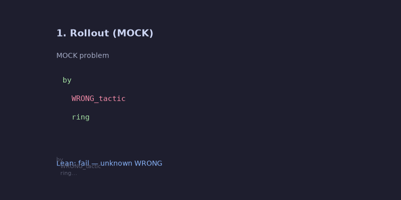
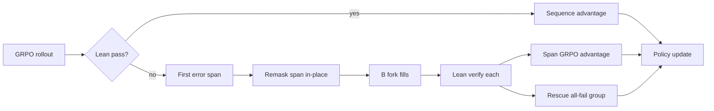

# kernelfork

[](https://github.com/Sebastianrodaaa/kernelfork/actions/workflows/ci.yml)
[](https://opensource.org/licenses/MIT)
[](https://www.python.org/downloads/)
[](#quickstart)

**Lean-kernel-located in-place forks for RL credit assignment in diffusion-LM theorem provers.**

During GRPO, failed Lean proofs trigger **remasking only the first failing tactic span**, drawing **B** counterfactual fills conditioned on prefix **and** suffix, verifying each with Lean, and using outcomes for **span-level advantages** plus **all-fail group rescue**.

> **Results in this repo:** CPU **MOCK** harness only until you run GPU repro. Any number not from a real miniF2F run is labeled **MOCK**.

<p align="center">
  
  <br/>
  <em>MOCK animation from <code>scripts/render_demo.py</code> (not real Lean/GPU training).</em>
</p>

## How it works



| Signal | Scope | Source |
|--------|-------|--------|
| Sequence advantage | Whole proof tokens | Terminal Lean pass/fail |
| Span advantage | Fork span tokens only | Compare B verified fills |
| Rescue | New group member | First passing fork in all-fail group |

**Key ablation:** `random_span` forks the same length at a **random** location — must underperform kernel-located forks or the hypothesis fails ([brief](./docs/REPORT.md)).

## Quickstart

```bash
git clone https://github.com/Sebastianrodaaa/kernelfork.git
cd kernelfork
pip install -e ".[dev]"

make test       # pytest (MOCK fixtures; skips @pytest.mark.lean)
make test-real  # real Lean 4 via `CliLeanClient` (requires elan)
make smoke      # one RL step → results/MOCK/smoke_step.json
make demo    # regenerate docs/demo.gif (MOCK)
```

### One RL step (MOCK)

```bash
python -m kernelfork.train_grpo \
  --arm kernelfork \
  --fixture tests/mock_data/problem.json \
  --forks 4 \
  --output results/MOCK/smoke_step.json
```

### Training arms

| Arm | Module | Description |
|-----|--------|-------------|
| `kernelfork` | `baselines/kernelfork.py` | Lean-located span forks |
| `diffu_grpo` | `baselines/diffu_grpo.py` | Sequence-level GRPO only |
| `dispo_branch` | `baselines/dispo_branch.py` | DiSPO-style random masked-state branch (MOCK) |
| `random_span` | `baselines/random_span.py` | Equal-length non-kernel spans |

```bash
python -m baselines.random_span --fixture tests/mock_data/problem.json
```

### Full repro (MOCK on CPU)

```bash
make repro   # 3 seeds × 4 arms → results/MOCK/step_*.json
```

**GPU + real Lean:** configure `ReplLeanClient` / `KERNELFORK_LEAN_REPL`, load [Pythagoras-Prover-Diffusion-4B](https://huggingface.co/Pythagoras-LM/Pythagoras-Prover-Diffusion-4B) (Apache-2.0, `a2d-qwen3`), then run the v1 plan in [docs/REPORT.md](./docs/REPORT.md). Real metrics go under `results/<run-id>/` (gitignored).

## Project layout

```
kernelfork/
  lean_client.py   # verify + first error span (mock + REPL stub)
  spans.py         # char ↔ token spans
  fork.py          # remask + two-sided fill
  advantage.py     # span vs sequence GRPO advantages
  train_grpo.py    # one RL step / arm switch
baselines/         # diffu_grpo, dispo_branch, random_span, kernelfork
scripts/
  build_splits.py  # statement-level train/eval JSONL
  repro_all_arms.sh
  render_demo.py
tests/mock_data/   # MOCK Lean fixtures
docs/
  RELATED_WORK.md
  REPORT.md
results/MOCK/      # committed MOCK JSON only
```

## Results table (MOCK — not benchmark numbers)

| Arm | pass@8 (miniF2F) | nonzero-adv groups | Notes |
|-----|------------------|--------------------|-------|
| diffu-GRPO | *pending* | *pending* | Real GPU run not executed in harness CI |
| DiSPO-branch | *pending* | *pending* | |
| random-span | *pending* | *pending* | Must be worse than kernelfork |
| **kernelfork** | *pending* | *pending* | Target: +3 pass@8 vs best baseline |

Generate plots from real JSON only:

```bash
# after real runs
python -c "import json,glob; print(len(glob.glob('results/MOCK/*.json')), 'MOCK files')"
```

## Third-party licenses

| Artifact | License | Source |
|----------|---------|--------|
| This repository | MIT | [LICENSE](./LICENSE) |
| Pythagoras-Prover-Diffusion-4B | Apache-2.0 | [HF model card](https://huggingface.co/Pythagoras-LM/Pythagoras-Prover-Diffusion-4B) |
| Mathlib | Apache-2.0 | [leanprover-community/mathlib4](https://github.com/leanprover-community/mathlib4) |
| Training datasets | See dataset cards | Pythagoras SFT / miniF2F upstream |

## Citation

```bibtex
@software{kernelfork2026,
  title  = {kernelfork: Lean-kernel-located in-place forks for dLLM GRPO},
  author = {Roda, Sebastian},
  year   = {2026},
  url    = {https://github.com/Sebastianrodaaa/kernelfork}
}
```

## Related reading

- [docs/RELATED_WORK.md](./docs/RELATED_WORK.md) — arXiv/GitHub survey (2026-10-30)
- [docs/REPORT.md](./docs/REPORT.md) — method, plan, limitations

## Contributing

Issues and PRs welcome. Please keep **MOCK** labels on any non-GPU/non-Lean numbers.
